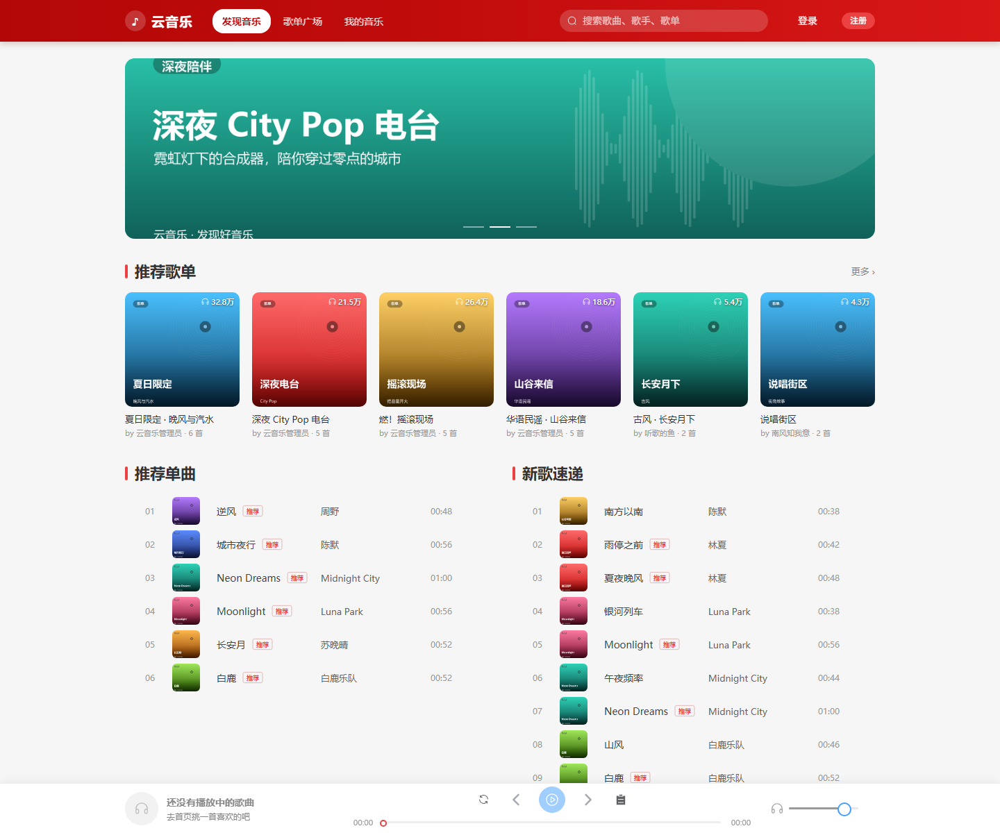
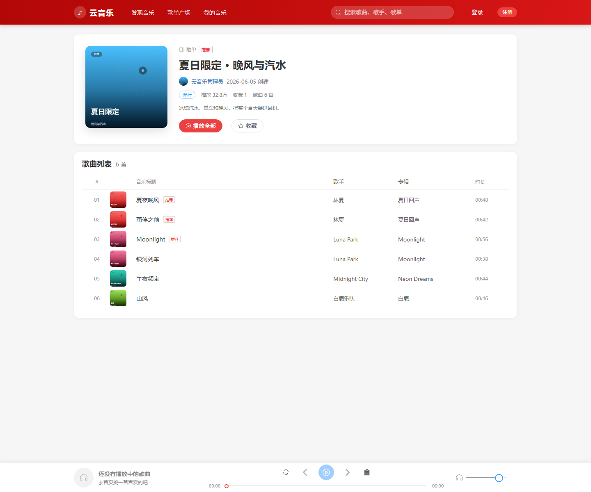
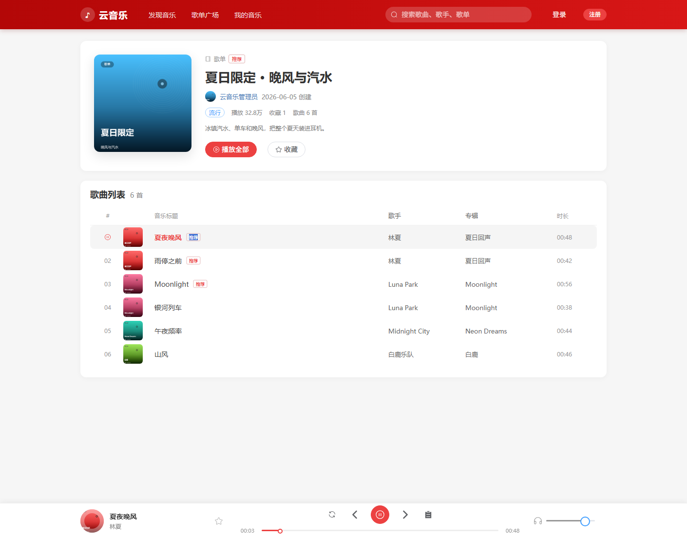
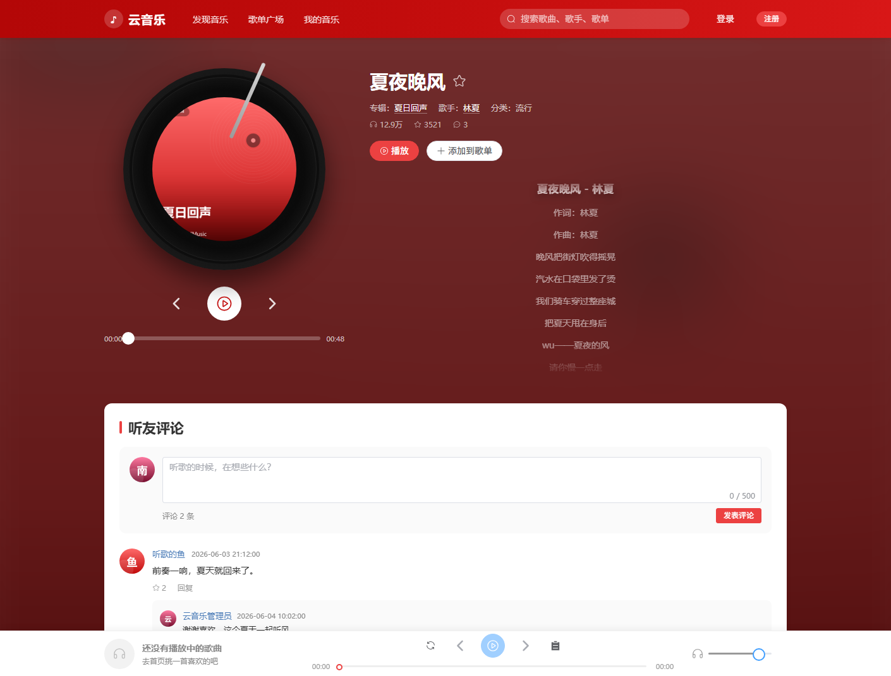
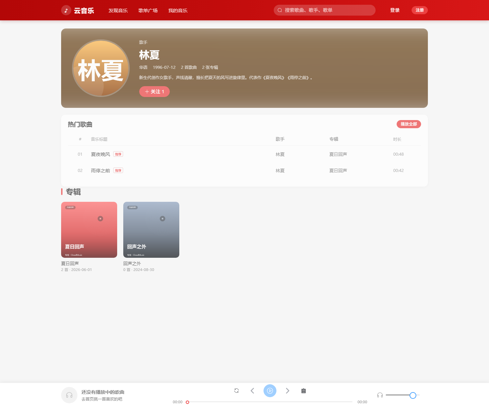
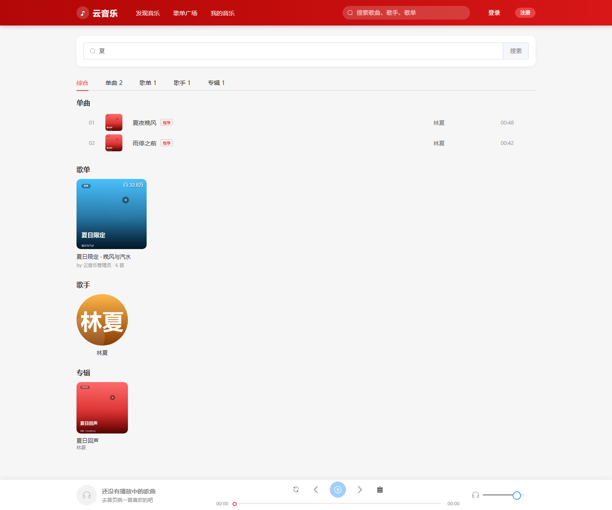
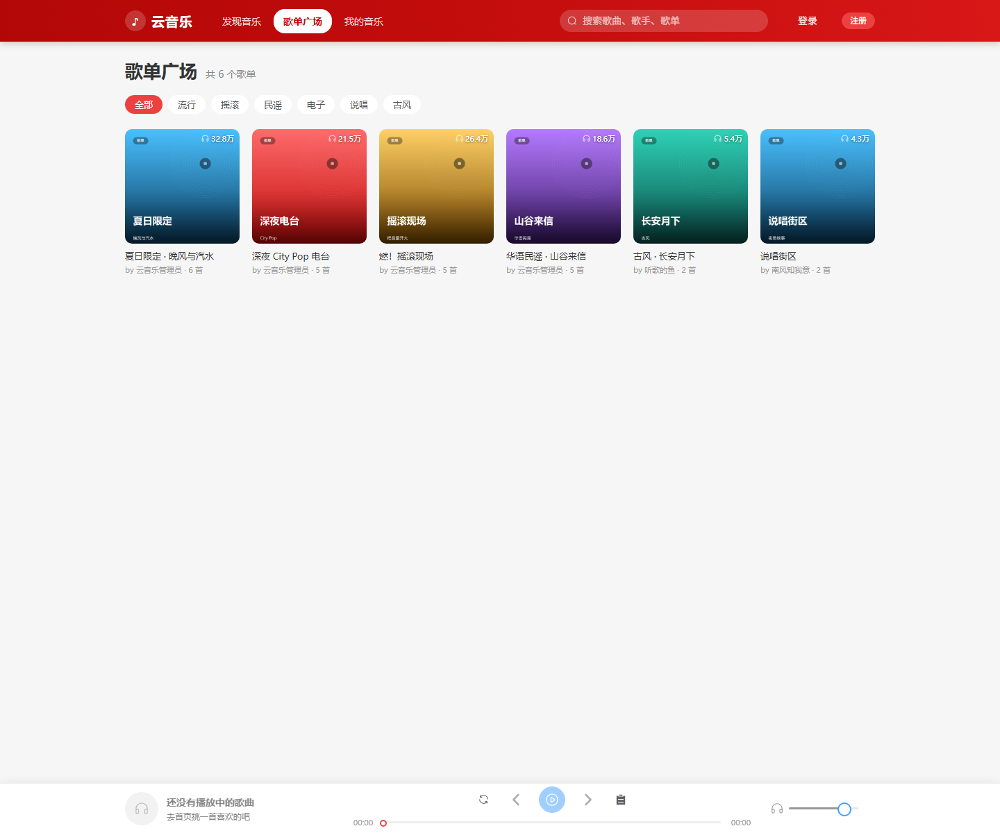
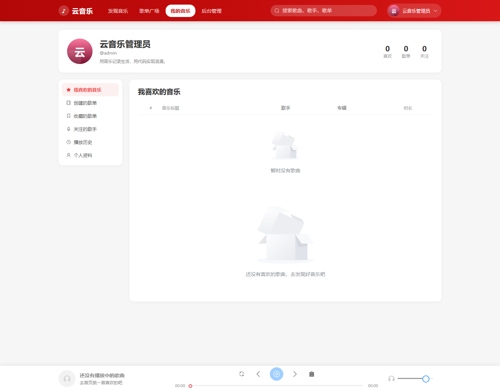
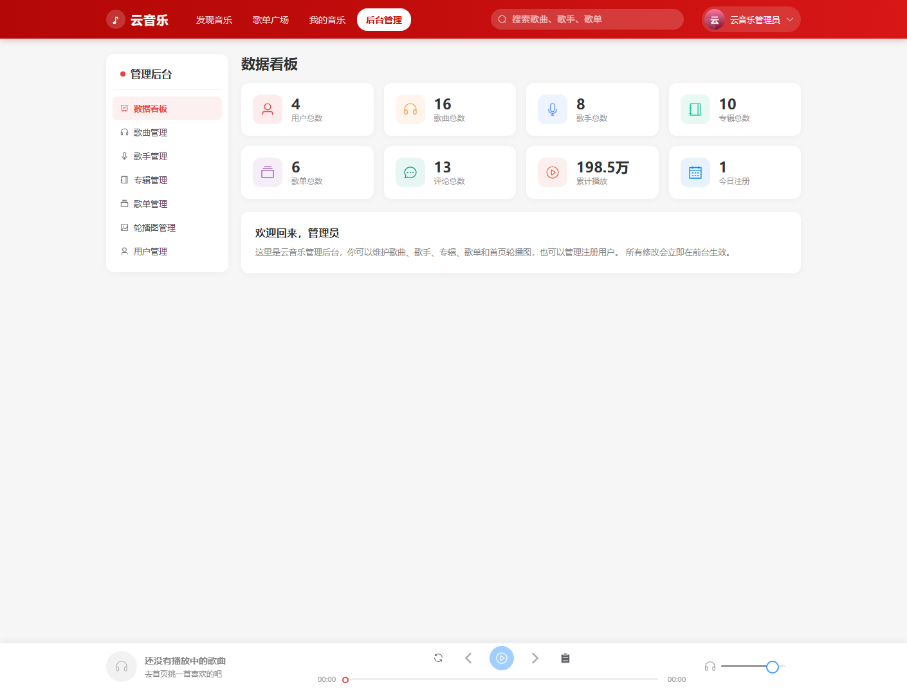

# 云音乐 · SpringBoot + Vue 仿网易云音乐

一个前后端分离的在线音乐平台示例项目：支持浏览/搜索歌曲、歌单与歌手，在线播放带 LRC 歌词滚动，登录后可点赞、收藏、评论、记录播放历史，管理员可在后台维护歌曲、歌手、专辑、歌单、轮播图与用户。

- 后端：Spring Boot 3.5.5 + MyBatis + MySQL 8
- 前端：Vue 3 + Vite 7 + Vue Router 4 + Pinia + Element Plus + Axios
- 演示数据：3 个用户、16 位歌手、18 张专辑、40 首歌曲、6 个歌单、12 条评论、3 张轮播图，附带可播放的试听音频与 LRC 歌词（`sql/music_extra.sql` 在基础数据之上追加了 8 位华语流行歌手与 24 首歌曲）



## 目录结构

```
music/
├── backend/                    Spring Boot 后端（端口 8080）
│   ├── pom.xml
│   └── src/main/
│       ├── java/com/zcy/music/
│       │   ├── common/         统一响应、异常、JWT、密码、拦截器、上下文
│       │   ├── config/         Web 配置（CORS、拦截器、静态资源）
│       │   ├── controller/     接口层
│       │   ├── dto/            请求参数
│       │   ├── entity/         数据库实体
│       │   ├── mapper/         MyBatis 注解式 Mapper
│       │   ├── service/        业务接口与实现
│       │   └── vo/             返回视图对象
│       └── resources/
│           ├── application.yml
│           └── static/         图片与音频（/images、/audio 直接由后端提供）
├── frontend/                   Vue 前端（开发端口 5173）
│   └── src/
│       ├── api/                axios 封装与全部接口
│       ├── assets/styles/      全局样式
│       ├── components/         Layout、PlayerBar、SongTable、PlaylistCard、CommentList、LoginDialog
│       ├── router/             路由与登录/管理员守卫
│       ├── stores/             user（登录态）、player（播放器）
│       ├── utils/              时间/播放量格式化、LRC 歌词解析
│       └── views/              Home、PlaylistSquare、PlaylistDetail、SongDetail、SingerDetail、AlbumDetail、Search、MyMusic、Admin、NotFound
├── docs/                       需求分析、数据库设计、部署运行指南、页面截图
├── sql/music.sql               建库建表 + 演示数据
├── tools/                      实体生成、密码哈希、素材生成、接口冒烟测试、截图脚本
├── start-backend.cmd           Windows 一键启动后端（缺 jar 时自动构建）
└── start-frontend.cmd          Windows 一键启动前端（缺依赖时自动安装）
```

## 功能一览

| 模块 | 功能 |
| --- | --- |
| 首页 | 轮播图、推荐歌单、推荐单曲、新歌速递、热门歌手 |
| 歌单 | 歌单广场分类筛选与分页、歌单详情、播放全部、收藏、创建/编辑/删除歌单、加歌/移除歌曲 |
| 播放 | 全局播放条、顺序/单曲/随机三种模式、播放队列、上一首/下一首、进度与音量、播放计数、播放历史 |
| 歌曲页 | 黑胶唱片动画、唱针、LRC 歌词高亮滚动（点击歌词跳转）、点赞、加入我的歌单、评论 |
| 搜索 | 综合/单曲/歌单/歌手/专辑 分栏结果、搜索历史（本地保存） |
| 用户 | 注册、登录（JWT 7 天）、个人资料、修改密码、我喜欢的音乐、收藏歌单、关注歌手 |
| 评论 | 一级评论分页、二级回复、点赞、删除（作者或管理员） |
| 后台 | 数据看板、歌曲/歌手/专辑/歌单/轮播图/用户的增删改查、用户角色与状态管理 |

## 页面截图

| 歌单详情 | 播放中 |
| --- | --- |
|  |  |

| 黑胶播放页 | 歌手详情 |
| --- | --- |
|  |  |

| 搜索结果 | 歌单广场 |
| --- | --- |
|  |  |

| 我的音乐 | 管理后台 |
| --- | --- |
|  |  |

## 快速开始

> 换一台电脑、换数据库密码、局域网访问、上线部署等场景，见 [docs/03-部署运行指南.md](docs/03-部署运行指南.md)；
> Windows 下也可以直接双击根目录的 `start-backend.cmd` / `start-frontend.cmd` 一键启动。

### 1. 准备数据库

要求 MySQL 8.0 已启动，默认账号 `root / 123456`。密码不同时不用改代码，启动后端前设置环境变量 `DB_PASSWORD` 即可（其它连接项见下表）。


```bash
mysql -uroot -p123456 --default-character-set=utf8mb4 < sql/music.sql
```

脚本会重建 `music_db`：14 张表 + 基础演示数据（歌曲时长与音频文件严格对应）。

想多几首华语流行歌，再执行一次追加脚本（可重复执行，不会重复插入）：

```bash
mysql -uroot -p123456 --default-character-set=utf8mb4 < sql/music_extra.sql
```

### 2. 启动后端

```bash
cd backend
mvn -DskipTests package
java -jar target/music-1.0.0.jar
```

启动后：<http://localhost:8080>，接口前缀 `/api`，静态图片 `/images/**`，音频 `/audio/**`。

连接信息都支持环境变量覆盖，换机器不用改代码：

| 环境变量 | 默认值 | 说明 |
| --- | --- | --- |
| `SERVER_PORT` | 8080 | 后端端口 |
| `DB_HOST` / `DB_PORT` | localhost / 3306 | MySQL 地址与端口 |
| `DB_NAME` | music_db | 数据库名 |
| `DB_USERNAME` / `DB_PASSWORD` | root / 123456 | 数据库账号密码 |
| `JWT_SECRET` | 内置演示密钥 | 生产环境请替换 |
| `JWT_EXPIRE_DAYS` | 7 | 登录有效期（天） |

```powershell
$env:DB_PASSWORD='你的密码'; java -jar backend\target\music-1.0.0.jar
```

```bash
DB_PASSWORD=你的密码 java -jar backend/target/music-1.0.0.jar
```

> 本项目在离线环境开发，依赖来自本地 Maven 仓库，因此当时使用 `-o`（离线）构建；换到联网电脑请去掉 `-o`。
> 若 `target` 下的文件被置为只读导致二次构建失败，可先清除只读属性，或在资源未变更时加 `-Dmaven.resources.skip=true`。

### 3. 启动前端

```bash
cd frontend
npm install
npm run dev
```

访问 <http://localhost:5173>，开发服务器会把 `/api`、`/images`、`/audio` 代理到 8080。

- 后端不在本机：`API_TARGET=http://192.168.1.10:8080 npm run dev`
- 改前端端口：`FRONTEND_PORT=8081 npm run dev`
- 局域网其它设备访问：`npm run dev -- --host`，再用 `http://内网IP:5173` 打开

生产构建：`npm run build`，产物在 `frontend/dist`；`npm run preview` 可本地预览构建结果。

### 演示账号

| 账号 | 密码 | 角色 |
| --- | --- | --- |
| admin | 123456 | 管理员（可进后台） |
| test | 123456 | 普通用户 |
| music | 123456 | 普通用户 |

也可以直接注册新账号（默认普通用户）。

## 接口设计

统一响应体：

```json
{ "code": 200, "message": "success", "data": {} }
```

`code`：200 成功、400 参数/业务错误、401 未登录或登录失效、403 无权限、404 不存在、500 服务器异常。

登录后请求头携带 `Authorization: Bearer <token>`（JWT，HS256，有效期 7 天）。

| 分组 | 接口 |
| --- | --- |
| 认证 | `POST /api/auth/register`、`POST /api/auth/login` |
| 首页 | `GET /api/home` |
| 歌曲 | `GET /api/song/page`、`GET /api/song/{id}`、`POST /api/song/{id}/play`、`POST /api/song/{id}/like` |
| 歌手 | `GET /api/singer/page`、`GET /api/singer/{id}`、`POST /api/singer/{id}/follow` |
| 专辑 | `GET /api/album/page`、`GET /api/album/{id}` |
| 歌单 | `GET /api/playlist/page`、`GET /api/playlist/{id}`、`GET /api/playlist/mine`、`GET /api/playlist/collected`、`POST /api/playlist`、`PUT /api/playlist/{id}`、`DELETE /api/playlist/{id}`、`POST/DELETE /api/playlist/{id}/song/{songId}`、`POST /api/playlist/{id}/play`、`POST /api/playlist/{id}/collect` |
| 搜索 | `GET /api/search?keyword=&limit=` |
| 评论 | `GET /api/comment/page?songId=`、`POST /api/comment`、`POST /api/comment/{id}/like`、`DELETE /api/comment/{id}` |
| 历史 | `POST /api/history?songId=`、`GET /api/history`、`DELETE /api/history`、`DELETE /api/history/{songId}` |
| 用户 | `GET/PUT /api/user/profile`、`PUT /api/user/password`、`GET /api/user/like/song`、`GET /api/user/collect/playlist`、`GET /api/user/follow/singer` |
| 分类 | `GET /api/category/list` |
| 后台 | `GET /api/admin/stats`、`GET/POST/DELETE /api/admin/song|singer|album|playlist|banner`、`GET /api/admin/user/page`、`PUT /api/admin/user/{id}` |

分页接口统一返回 `{ total, list }`，参数 `page`（默认 1）、`size`（默认 10，最大 100）。

完整字段与表结构见 [docs/02-数据库设计.md](docs/02-数据库设计.md)，需求与用例见 [docs/01-需求分析.md](docs/01-需求分析.md)。

## 数据库

14 张表：`user`、`singer`、`album`、`category`、`song`、`playlist`、`playlist_song`、`comment`、`comment_like`、`user_song`、`user_playlist`、`user_singer`、`play_history`、`banner`。

- 不建物理外键，靠索引与应用层校验维护一致性（便于演示数据导入与后台维护）
- 收藏/点赞表用唯一索引保证幂等，`user_song` 等中间表 `INSERT IGNORE`
- 播放历史 `ON DUPLICATE KEY UPDATE play_time = NOW()`
- 评论采用一级 + 二级结构，回复的回复统一挂到父评论下
- 密码使用 PBKDF2-HMAC-SHA256（10000 次迭代、8 字节随机盐）存储，格式 `迭代次数$盐$哈希`

## 开发工具脚本（tools/）

| 脚本 | 用途 |
| --- | --- |
| `gen_entities.py` | 根据表结构生成实体类（getter/setter、日期格式、密码 `@JsonIgnore`） |
| `gen_password.py` | 生成与后端一致的 PBKDF2 密码哈希，便于手工插入用户 |
| `gen_assets.py` | 合成专辑/歌手/歌单封面、头像、轮播图与 8 段 WAV 试听音频 |
| `smoke_api.mjs` | 22 项接口冒烟测试（首页、分页、搜索、评论、登录、后台鉴权、点赞、历史、注册等） |
| `shot_auth.mjs` / `shot_play.mjs` | 用无头 Edge + CDP 注入登录态、模拟播放并截图 |

冒烟测试用法（需后端已启动）：

```bash
node tools/smoke_api.mjs
```

## 说明与限制

- 音频为程序合成的 8 段 WAV 试听片段（每段 38～60 秒），仅用于演示播放与歌词联动，不含真实版权音乐。
- 图片均为脚本生成的渐变封面，不含第三方素材。
- JWT 密钥写在 `application.yml` 的 `music.jwt.secret`，仅用于教学演示，生产环境请改为环境变量注入。
- 前端为单页应用，路由使用 history 模式；部署到 Nginx 时需配置 `try_files $uri $uri/ /index.html`，并将 `/api`、`/images`、`/audio` 反向代理到后端。
- 构建环境注意：若在受限沙箱中执行 `vite build` / `vite dev`，esbuild 需要以子进程方式启动，可能因权限不足报 `spawn EPERM`；同时建议把 `TEMP` 指向工作区目录，避免临时文件删除失败。
