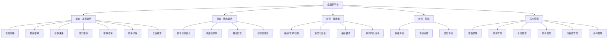
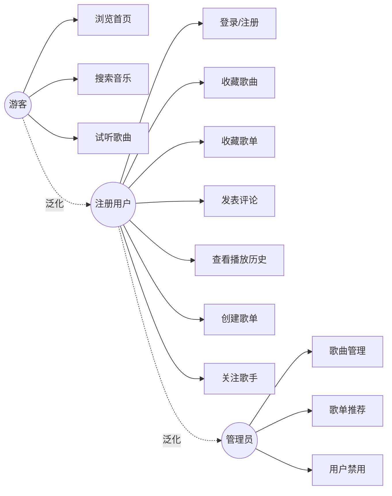
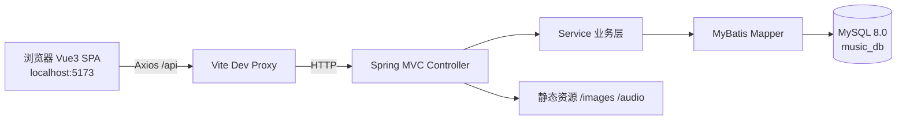

# 仿网易云音乐 · 需求分析说明书

> 项目名称：云音乐（CloudMusic）——SpringBoot + Vue 前后端分离音乐平台
> 文档版本：v1.0
> 编写日期：2026-11-04
> 适用阶段：课程设计 / 毕业设计 / 个人全栈练习

---

## 1. 项目概述

### 1.1 项目背景

网易云音乐是国内最受欢迎的在线音乐平台之一，其核心竞争力在于「发现音乐 + 歌单文化 + 评论区氛围」。
本项目以网易云音乐 Web 端为参考原型，使用 **SpringBoot 3 + MyBatis + MySQL 8 + Vue 3** 实现一个功能完整、结构规范的前后端分离音乐平台，覆盖「浏览 → 播放 → 收藏 → 评论 → 后台管理」的完整业务闭环。

需要说明的是：本项目是**教学性质的仿写**，只复刻产品形态与业务流程，不使用网易云音乐的商标、曲库与接口；封面、音频等素材均为本地生成的演示资源。

### 1.2 项目目标

| 目标 | 说明 |
| --- | --- |
| 业务完整 | 实现音乐平台的核心链路：发现音乐 → 歌单 → 播放 → 收藏 → 评论 → 个人中心 |
| 架构规范 | 前后端分离，RESTful API，统一响应体，JWT 无状态鉴权 |
| 数据驱动 | 14 张业务表，覆盖用户、曲库、歌单、互动、运营五大域 |
| 可运行 | 一条 SQL 初始化数据库，后端 `mvn spring-boot:run`、前端 `npm run dev` 即可访问 |
| 可扩展 | 分层清晰（Controller / Service / Mapper），便于继续增加功能 |

### 1.3 参考产品

- 网易云音乐 Web 端（music.163.com）：顶部导航、轮播推荐、歌单广场、底部播放条
- 网易云音乐「黑胶播放页」：唱片旋转、逐行歌词滚动、评论区

---

## 2. 用户角色与权限

| 角色 | 说明 | 可用功能 |
| --- | --- | --- |
| 游客（未登录） | 直接访问首页 | 浏览轮播/歌单/歌曲/歌手、搜索、试听、查看评论 |
| 注册用户 | 登录后的普通用户（`role = 0`） | 游客全部功能 + 收藏歌曲/歌单、关注歌手、发表评论、点赞、播放历史、创建歌单 |
| 管理员 | 后台运营人员（`role = 1`） | 用户全部功能 + 歌曲/歌手/专辑/歌单/轮播图/用户管理 |

权限控制规则：

1. 浏览类接口（GET `/api/song/**`、`/api/playlist/**` 等）匿名可访问；
2. 写操作（收藏、评论、历史、创建歌单）必须携带合法 JWT；
3. 后台接口统一以 `/api/admin/**` 开头，除登录校验外还需校验 `role = 1`；
4. 密码采用 PBKDF2 加盐哈希存储，任何接口都不返回密码字段。

---

## 3. 功能需求

### 3.1 功能结构图



### 3.2 前台功能需求

#### 3.2.1 首页 / 发现音乐（FR-01）

| 编号 | 功能 | 描述 | 优先级 |
| --- | --- | --- | --- |
| FR-01-1 | 轮播图 | 展示后台配置的运营 Banner（图片、标题、跳转目标），自动轮播 | 高 |
| FR-01-2 | 推荐歌单 | 展示 `is_recommend = 1` 的歌单，卡片含封面、名称、播放量 | 高 |
| FR-01-3 | 新歌速递 | 按发布时间倒序展示歌曲，可直接播放 | 高 |
| FR-01-4 | 热门歌手 | 展示关注数最高的歌手，点击进入歌手页 | 中 |
| FR-01-5 | 侧边导航 | 发现音乐 / 我的音乐 / 我关注的歌手 / 后台管理（管理员可见） | 中 |

#### 3.2.2 歌单（FR-02）

| 编号 | 功能 | 描述 | 优先级 |
| --- | --- | --- | --- |
| FR-02-1 | 歌单详情 | 封面、名称、创建者、简介、标签、播放量、收藏量、歌曲列表 | 高 |
| FR-02-2 | 播放全部 | 一键把歌单内歌曲加入播放队列 | 高 |
| FR-02-3 | 收藏歌单 | 登录后可收藏/取消收藏，收藏数实时 ±1 | 高 |
| FR-02-4 | 创建歌单 | 登录用户可创建自己的歌单（名称、简介、封面） | 中 |
| FR-02-5 | 歌单加歌/删歌 | 仅歌单创建者可维护歌单内歌曲 | 中 |
| FR-02-6 | 歌单分类 | 按分类（流行/摇滚/民谣/电子/说唱/古风）筛选歌单 | 低 |

#### 3.2.3 歌曲与播放（FR-03）

| 编号 | 功能 | 描述 | 优先级 |
| --- | --- | --- | --- |
| FR-03-1 | 歌曲详情 | 歌曲名、歌手、专辑、时长、封面、歌词、评论数 | 高 |
| FR-03-2 | 音频播放 | HTML5 Audio 播放，支持暂停、拖动进度、音量调节 | 高 |
| FR-03-3 | 播放队列 | 支持「顺序播放 / 单曲循环 / 随机播放」三种模式 | 高 |
| FR-03-4 | 歌词滚动 | LRC 歌词按时间轴高亮滚动，点击歌词跳转播放位置 | 高 |
| FR-03-5 | 喜欢歌曲 | 红心收藏，写入 `user_song`，歌曲 `like_count` ±1 | 高 |
| FR-03-6 | 播放历史 | 播放超过 5 秒记录一次，同一首歌只保留最新一条 | 中 |
| FR-03-7 | 播放计数 | 每次播放 `song.play_count` +1 | 低 |

#### 3.2.4 搜索（FR-04）

| 编号 | 功能 | 描述 | 优先级 |
| --- | --- | --- | --- |
| FR-04-1 | 综合搜索 | 关键字模糊匹配歌曲名、歌手名、歌单名 | 高 |
| FR-04-2 | 分类结果 | 结果分「单曲 / 歌手 / 歌单」三个 Tab | 高 |
| FR-04-3 | 搜索历史 | 前端本地保存最近 10 条搜索词 | 低 |

#### 3.2.5 用户中心（FR-05）

| 编号 | 功能 | 描述 | 优先级 |
| --- | --- | --- | --- |
| FR-05-1 | 注册 | 用户名唯一、密码 6~20 位、昵称必填 | 高 |
| FR-05-2 | 登录 | 用户名 + 密码，返回 JWT（有效期 7 天） | 高 |
| FR-05-3 | 个人资料 | 查看/修改昵称、签名、性别、生日、头像地址 | 中 |
| FR-05-4 | 修改密码 | 校验原密码，新密码加盐后重新存储 | 中 |
| FR-05-5 | 我喜欢的音乐 | 收藏的歌曲列表，可取消收藏 | 高 |
| FR-05-6 | 收藏的歌单 | 收藏过的歌单列表 | 中 |
| FR-05-7 | 关注歌手 | 关注/取关歌手，歌手页展示关注状态 | 低 |

#### 3.2.6 评论互动（FR-06）

| 编号 | 功能 | 描述 | 优先级 |
| --- | --- | --- | --- |
| FR-06-1 | 评论列表 | 按时间倒序分页展示，含用户昵称、头像、时间 | 高 |
| FR-06-2 | 发表评论 | 1~500 字，登录后可发，`comment_count` +1 | 高 |
| FR-06-3 | 回复评论 | 二级回复（`parent_id` 指向父评论） | 中 |
| FR-06-4 | 点赞评论 | 每人每条评论只能赞一次，可取消 | 中 |
| FR-06-5 | 删除评论 | 本人或管理员可删除（逻辑删除） | 低 |

### 3.3 后台管理功能需求（FR-07）

后台为独立的 `/admin` 路由，采用「左侧菜单 + 右侧表格 + 弹窗表单」的经典布局。

| 编号 | 模块 | 功能 | 优先级 |
| --- | --- | --- | --- |
| FR-07-1 | 数据看板 | 歌曲数、用户数、歌单数、评论数统计 | 低 |
| FR-07-2 | 歌曲管理 | 分页查询、新增、编辑、上下架、删除 | 高 |
| FR-07-3 | 歌手管理 | 分页查询、新增、编辑、删除 | 中 |
| FR-07-4 | 专辑管理 | 分页查询、新增、编辑、删除 | 低 |
| FR-07-5 | 歌单管理 | 分页查询、推荐/取消推荐、删除 | 中 |
| FR-07-6 | 轮播图管理 | 新增、排序、启用/禁用、删除 | 中 |
| FR-07-7 | 用户管理 | 分页查询、启用/禁用账号 | 低 |

---

## 4. 用例分析

### 4.1 用例图



### 4.2 核心用例描述

**UC-01 用户登录**

- 参与者：注册用户
- 前置条件：账号已注册且状态正常
- 基本流程：
  1. 用户点击「登录」，弹出登录框；
  2. 输入用户名、密码，前端做非空校验；
  3. 后端校验用户名是否存在、密码哈希是否匹配、账号是否被禁用；
  4. 校验通过，签发 JWT 返回 `{ token, userInfo }`；
  5. 前端持久化 token（localStorage），刷新页面自动恢复登录态。
- 异常流程：密码错误返回 `4001`；账号禁用返回 `4003`。

**UC-02 播放歌曲**

- 参与者：游客 / 注册用户
- 基本流程：
  1. 用户在列表点击播放按钮；
  2. 前端把歌曲加入播放队列并调用音频组件播放；
  3. 播放超过 5 秒后，若已登录则上报播放历史、播放量 +1；
  4. 底部播放条展示封面、歌名、歌手、进度、音量；
  5. 用户可暂停、拖动进度、切换上一首/下一首/播放模式。

**UC-03 发表评论**

- 参与者：注册用户
- 前置条件：已登录
- 基本流程：
  1. 进入歌曲详情页评论区，输入内容；
  2. 前端校验 1~500 字；
  3. 后端写入 `comment` 表，`song.comment_count` +1；
  4. 返回评论对象，前端插入列表首位。

**UC-04 后台新增歌曲**

- 参与者：管理员
- 基本流程：
  1. 管理员进入「歌曲管理」，点击「新增」；
  2. 填写歌名、歌手、专辑、分类、时长、封面、音频地址、歌词；
  3. 提交后校验必填项，写入 `song` 表；
  4. 列表刷新，前台「新歌速递」同步可见。

---

## 5. 非功能需求

| 类别 | 要求 |
| --- | --- |
| 性能 | 单表查询响应 < 200ms；列表接口全部分页；首页接口聚合返回，减少请求数 |
| 安全 | 密码 PBKDF2 加盐；JWT 签名校验；接口参数校验；SQL 使用 MyBatis 预编译防注入；后台接口校验角色 |
| 兼容 | Chrome / Edge 最新版；视口 ≥ 1280px 为主，兼容 1024px |
| 可用性 | 接口统一响应体；前端错误用 ElMessage 提示；空数据展示缺省图 |
| 可维护性 | 分层架构；统一异常处理；数据库字段带注释；代码注释使用中文 |
| 编码 | 全链路 UTF-8；数据库 `utf8mb4`；时间统一 `Asia/Shanghai` |

---

## 6. 技术选型与系统架构

### 6.1 技术栈

| 层次 | 技术 | 版本 | 说明 |
| --- | --- | --- | --- |
| 前端框架 | Vue | 3.5 | Composition API + `<script setup>` |
| 构建工具 | Vite | 7.x | 开发热更新、代理后端 |
| 路由/状态 | Vue Router 4 / Pinia 3 | - | 路由守卫、播放器全局状态 |
| UI 组件 | Element Plus | 2.x | 表格、表单、弹窗、分页 |
| HTTP | Axios | 1.x | 请求/响应拦截器统一处理 token 与错误 |
| 后端框架 | Spring Boot | 3.5.5 | Java 17 |
| 持久层 | MyBatis | 3.0.5 (starter) | 注解 + 动态 SQL |
| 数据库 | MySQL | 8.0 | InnoDB / utf8mb4 |
| 鉴权 | JWT (HS256) | 自实现 | HMAC-SHA256 + Base64URL，无第三方依赖 |
| 密码 | PBKDF2WithHmacSHA256 | JDK 内置 | 盐值随机，迭代 10000 次 |

### 6.2 系统架构



### 6.3 项目目录结构

```
music/
├── docs/                 # 需求分析、数据库设计文档
├── sql/music.sql         # 建库建表 + 演示数据
├── tools/                # 资源生成、实体生成脚本
├── backend/              # SpringBoot 后端（端口 8080）
│   └── src/main/java/com/zcy/music/
│       ├── common/       # 统一响应、异常、JWT、拦截器
│       ├── controller/   # 接口层
│       ├── service/      # 业务层
│       ├── mapper/       # MyBatis Mapper
│       ├── entity/       # 数据库实体
│       ├── dto/          # 入参对象
│       └── vo/           # 出参对象
└── frontend/             # Vue3 前端（端口 5173）
    └── src/
        ├── api/          # 接口封装
        ├── components/   # 公共组件（播放器、歌曲列表、登录框）
        ├── views/        # 页面
        ├── router/       # 路由
        ├── stores/       # Pinia 状态
        └── assets/       # 样式与图标
```

---

## 7. 接口规范

### 7.1 统一响应体

```json
{
  "code": 200,
  "message": "success",
  "data": { }
}
```

| code | 含义 |
| --- | --- |
| 200 | 成功 |
| 400 | 参数错误 / 业务校验失败 |
| 401 | 未登录或 token 失效 |
| 403 | 无权限（非管理员访问后台） |
| 404 | 资源不存在 |
| 500 | 服务器内部错误 |

### 7.2 鉴权方式

请求头携带 `Authorization: Bearer <token>`。JWT payload 包含 `userId`、`username`、`role`，有效期 7 天。

### 7.3 接口清单（节选）

| 方法 | 路径 | 说明 | 鉴权 |
| --- | --- | --- | --- |
| POST | `/api/auth/register` | 注册 | 否 |
| POST | `/api/auth/login` | 登录 | 否 |
| GET | `/api/home` | 首页聚合数据（轮播/推荐歌单/新歌/歌手） | 否 |
| GET | `/api/song/page` | 歌曲分页（关键字/分类/歌手） | 否 |
| GET | `/api/song/{id}` | 歌曲详情（含歌词、歌手、专辑） | 否 |
| GET | `/api/singer/page` | 歌手分页 | 否 |
| GET | `/api/singer/{id}` | 歌手详情 + 热门歌曲 + 专辑 | 否 |
| GET | `/api/playlist/page` | 歌单分页 | 否 |
| GET | `/api/playlist/{id}` | 歌单详情（含歌曲列表） | 否 |
| GET | `/api/search` | 综合搜索 | 否 |
| POST | `/api/song/{id}/like` | 喜欢/取消喜欢 | 是 |
| POST | `/api/playlist/{id}/collect` | 收藏/取消收藏歌单 | 是 |
| GET | `/api/comment/page` | 歌曲评论分页 | 否 |
| POST | `/api/comment` | 发表评论 | 是 |
| POST | `/api/comment/{id}/like` | 点赞/取消点赞评论 | 是 |
| POST | `/api/history` | 上报播放记录 | 是 |
| GET | `/api/history` | 我的播放历史 | 是 |
| GET | `/api/user/profile` | 我的资料 | 是 |
| PUT | `/api/user/profile` | 修改资料 | 是 |
| GET | `/api/user/like/song` | 我喜欢的音乐 | 是 |
| GET | `/api/user/collect/playlist` | 收藏的歌单 | 是 |
| GET/POST/PUT/DELETE | `/api/admin/song/**` | 歌曲管理 | 管理员 |
| GET/POST/PUT/DELETE | `/api/admin/singer/**` | 歌手管理 | 管理员 |
| GET/PUT | `/api/admin/playlist/**` | 歌单管理 | 管理员 |
| GET/POST/PUT/DELETE | `/api/admin/banner/**` | 轮播图管理 | 管理员 |
| GET/PUT | `/api/admin/user/**` | 用户管理 | 管理员 |

完整接口以 `backend` 实际代码为准。

---

## 8. 页面清单与原型说明

| 路由 | 页面 | 主要内容 |
| --- | --- | --- |
| `/` | 发现音乐 | 轮播、推荐歌单、新歌速递、热门歌手 |
| `/playlist/:id` | 歌单详情 | 歌单信息头 + 歌曲表格 + 播放全部 |
| `/song/:id` | 歌曲详情 | 黑胶唱片、歌词滚动、评论区 |
| `/singer/:id` | 歌手详情 | 歌手信息、热门歌曲、专辑 |
| `/search` | 搜索结果 | 关键字、单曲/歌手/歌单 Tab |
| `/my` | 我的音乐 | 我喜欢、收藏歌单、播放历史 |
| `/admin` | 后台管理 | 左侧菜单 + 数据表格 + 弹窗编辑 |
| — | 全局播放条 | 封面、歌名、进度、音量、播放模式 |
| — | 登录/注册弹窗 | 表单校验、token 落地 |

交互约定：所有页面共用顶部导航与底部播放条；未登录点击收藏/评论时弹出登录框；切歌不打断页面浏览。

---

## 9. 验收标准与里程碑

### 9.1 三个阶段的交付物

| 阶段 | 交付物 | 验收方式 |
| --- | --- | --- |
| ① 需求分析 | 本文件：角色、功能清单、用例、接口规范 | 文档评审通过 |
| ② 数据库设计 | `docs/02-数据库设计.md` + `sql/music.sql` | 脚本可一键建库并导入演示数据 |
| ③ 项目创建 | `backend` + `frontend` 两个可运行工程 | 后端接口可访问、前端页面可打开并完成登录→播放→收藏→评论链路 |

### 9.2 功能验收清单

- [ ] 注册 / 登录 / 退出，刷新后登录态保持
- [ ] 首页轮播、推荐歌单、新歌、歌手正常展示
- [ ] 歌单详情可播放全部，收藏数正确变化
- [ ] 播放器可暂停、拖动、切歌、切换播放模式
- [ ] 歌词随播放进度高亮
- [ ] 搜索可按单曲/歌手/歌单分类展示
- [ ] 评论可发表、点赞、回复
- [ ] 我的音乐可查看喜欢、收藏、历史
- [ ] 管理员可对歌曲/歌手/轮播图增删改查
- [ ] 未登录时写操作被拦截并提示登录

### 9.3 迭代计划

1. 第 1 周：需求分析、数据库设计、建库导数据；
2. 第 2 周：后端骨架、认证模块、曲库与歌单接口；
3. 第 3 周：前端骨架、首页、歌单页、播放器；
4. 第 4 周：评论、个人中心、后台管理、联调与验收。
