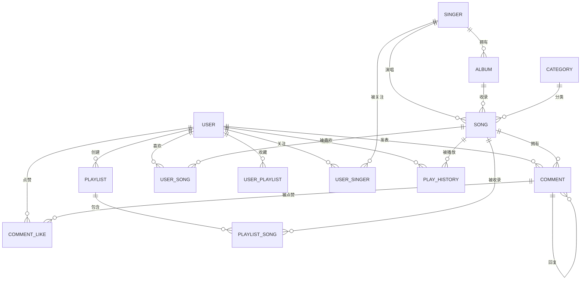

# 仿网易云音乐 · 数据库设计说明书

> 数据库：`music_db`　字符集：`utf8mb4`　排序规则：`utf8mb4_general_ci`　引擎：`InnoDB`
> 配套脚本：`sql/music.sql`（建库 + 建表 + 演示数据，可重复执行）

---

## 1. 设计目标与原则

1. **第三范式为主**：歌曲、歌手、专辑、分类拆表，避免冗余；统计类字段（播放量、点赞数）适度冗余，用「写时更新」换「读时聚合」的性能。
2. **逻辑删除**：歌曲、歌单、评论使用 `status` 字段（1 正常 / 0 下架或删除），保留运营追溯能力。
3. **唯一约束防重**：收藏、关注、点赞、播放历史均建联合唯一索引，重复操作转为「取消」。
4. **可读性**：所有表、字段均写中文注释；主键统一 `id BIGINT UNSIGNED AUTO_INCREMENT`；时间字段统一 `DATETIME`。
5. **字符集**：`utf8mb4` 支持中文、生僻字与 Emoji（评论区常见）。

---

## 2. 实体关系（ER 图）



---

## 3. 表清单

| 序号 | 表名 | 中文名 | 所属域 | 说明 |
| --- | --- | --- | --- | --- |
| 1 | `user` | 用户表 | 用户 | 普通用户与管理员共用，`role` 区分 |
| 2 | `singer` | 歌手表 | 曲库 | 歌手基本信息 |
| 3 | `album` | 专辑表 | 曲库 | 专辑归属歌手 |
| 4 | `category` | 歌曲分类表 | 曲库 | 流行/摇滚/民谣… |
| 5 | `song` | 歌曲表 | 曲库 | 核心表，含音频地址与歌词 |
| 6 | `playlist` | 歌单表 | 歌单 | 用户创建或官方推荐 |
| 7 | `playlist_song` | 歌单歌曲关联表 | 歌单 | 多对多，带排序 |
| 8 | `comment` | 评论表 | 互动 | 支持二级回复 |
| 9 | `comment_like` | 评论点赞表 | 互动 | 记录谁赞了哪条 |
| 10 | `user_song` | 用户喜欢的歌曲 | 互动 | 「我喜欢的音乐」 |
| 11 | `user_playlist` | 用户收藏的歌单 | 互动 | 收藏关系 |
| 12 | `user_singer` | 用户关注的歌手 | 互动 | 关注关系 |
| 13 | `play_history` | 播放历史表 | 行为 | 每首歌仅保留最近一条 |
| 14 | `banner` | 轮播图表 | 运营 | 首页运营位 |

---

## 4. 表结构详细设计

### 4.1 用户表 `user`

| 字段 | 类型 | 允许空 | 默认值 | 说明 |
| --- | --- | --- | --- | --- |
| `id` | BIGINT UNSIGNED | 否 | 自增 | 主键 |
| `username` | VARCHAR(50) | 否 | - | 登录账号，唯一 |
| `password` | VARCHAR(128) | 否 | - | `迭代次数$盐$哈希`（PBKDF2-SHA256） |
| `nickname` | VARCHAR(50) | 否 | - | 昵称 |
| `avatar` | VARCHAR(255) | 是 | NULL | 头像地址 |
| `gender` | TINYINT | 否 | 0 | 0 未知 / 1 男 / 2 女 |
| `birthday` | DATE | 是 | NULL | 生日 |
| `signature` | VARCHAR(255) | 是 | 默认签名 | 个性签名 |
| `phone` | VARCHAR(20) | 是 | NULL | 手机号 |
| `email` | VARCHAR(100) | 是 | NULL | 邮箱 |
| `role` | TINYINT | 否 | 0 | 0 普通用户 / 1 管理员 |
| `status` | TINYINT | 否 | 1 | 1 正常 / 0 禁用 |
| `create_time` | DATETIME | 否 | CURRENT_TIMESTAMP | 注册时间 |
| `update_time` | DATETIME | 否 | 自动更新 | 更新时间 |

索引：`uk_username(username)`。

### 4.2 歌手表 `singer`

| 字段 | 类型 | 说明 |
| --- | --- | --- |
| `id` | BIGINT UNSIGNED | 主键 |
| `name` | VARCHAR(50) | 歌手名，唯一 |
| `avatar` | VARCHAR(255) | 方形头像 |
| `cover` | VARCHAR(255) | 歌手页大图 |
| `gender` | TINYINT | 0 组合 / 1 男 / 2 女 |
| `region` | VARCHAR(50) | 地区（华语/欧美/日韩…） |
| `birthday` | DATE | 出生日期 |
| `intro` | TEXT | 歌手简介 |
| `follow_count` | INT | 关注数（冗余统计） |
| `create_time` | DATETIME | 创建时间 |

### 4.3 专辑表 `album`

| 字段 | 类型 | 说明 |
| --- | --- | --- |
| `id` | BIGINT UNSIGNED | 主键 |
| `name` | VARCHAR(100) | 专辑名 |
| `singer_id` | BIGINT UNSIGNED | 所属歌手 |
| `cover` | VARCHAR(255) | 封面 |
| `publish_date` | DATE | 发行日期 |
| `company` | VARCHAR(100) | 唱片公司 |
| `intro` | TEXT | 专辑简介 |
| `create_time` | DATETIME | 创建时间 |

索引：`idx_singer(singer_id)`。

### 4.4 歌曲分类表 `category`

| 字段 | 类型 | 说明 |
| --- | --- | --- |
| `id` | INT UNSIGNED | 主键 |
| `name` | VARCHAR(20) | 分类名，唯一 |
| `sort` | INT | 排序值 |

### 4.5 歌曲表 `song`

| 字段 | 类型 | 说明 |
| --- | --- | --- |
| `id` | BIGINT UNSIGNED | 主键 |
| `name` | VARCHAR(100) | 歌曲名 |
| `singer_id` | BIGINT UNSIGNED | 歌手 |
| `album_id` | BIGINT UNSIGNED | 专辑（可为空：单曲） |
| `cover` | VARCHAR(255) | 封面 |
| `audio_url` | VARCHAR(255) | 音频地址（本地 `/audio/xxx.wav`） |
| `lyric` | LONGTEXT | LRC 歌词全文 |
| `duration` | INT | 时长（秒） |
| `category_id` | INT UNSIGNED | 分类 |
| `play_count` | INT | 播放量 |
| `like_count` | INT | 喜欢数 |
| `comment_count` | INT | 评论数 |
| `is_recommend` | TINYINT | 1 推荐 / 0 普通 |
| `status` | TINYINT | 1 上架 / 0 下架 |
| `create_time` | DATETIME | 发布时间 |
| `update_time` | DATETIME | 更新时间 |

索引：`idx_singer(singer_id)`、`idx_album(album_id)`、`idx_category(category_id)`、`idx_name(name)`。

### 4.6 歌单表 `playlist`

| 字段 | 类型 | 说明 |
| --- | --- | --- |
| `id` | BIGINT UNSIGNED | 主键 |
| `name` | VARCHAR(100) | 歌单名 |
| `cover` | VARCHAR(255) | 封面 |
| `intro` | TEXT | 简介 |
| `user_id` | BIGINT UNSIGNED | 创建者 |
| `category` | VARCHAR(20) | 分类标签 |
| `play_count` | INT | 播放量 |
| `collect_count` | INT | 收藏量 |
| `is_recommend` | TINYINT | 1 首页推荐 |
| `status` | TINYINT | 1 正常 / 0 删除 |
| `create_time` | DATETIME | 创建时间 |
| `update_time` | DATETIME | 更新时间 |

索引：`idx_user(user_id)`、`idx_recommend(is_recommend)`。

### 4.7 歌单歌曲关联表 `playlist_song`

| 字段 | 类型 | 说明 |
| --- | --- | --- |
| `id` | BIGINT UNSIGNED | 主键 |
| `playlist_id` | BIGINT UNSIGNED | 歌单 |
| `song_id` | BIGINT UNSIGNED | 歌曲 |
| `sort` | INT | 歌单内排序（从 1 开始） |
| `create_time` | DATETIME | 加入时间 |

约束：`uk_playlist_song(playlist_id, song_id)`，避免同一首歌重复加入。

### 4.8 评论表 `comment`

| 字段 | 类型 | 说明 |
| --- | --- | --- |
| `id` | BIGINT UNSIGNED | 主键 |
| `song_id` | BIGINT UNSIGNED | 所属歌曲 |
| `user_id` | BIGINT UNSIGNED | 评论人 |
| `content` | VARCHAR(500) | 内容 |
| `parent_id` | BIGINT UNSIGNED | 父评论 ID，0 表示一级评论 |
| `like_count` | INT | 点赞数 |
| `status` | TINYINT | 1 正常 / 0 删除 |
| `create_time` | DATETIME | 评论时间 |

索引：`idx_song(song_id, create_time)`、`idx_parent(parent_id)`。

### 4.9 评论点赞表 `comment_like`

| 字段 | 类型 | 说明 |
| --- | --- | --- |
| `id` | BIGINT UNSIGNED | 主键 |
| `comment_id` | BIGINT UNSIGNED | 评论 |
| `user_id` | BIGINT UNSIGNED | 点赞人 |
| `create_time` | DATETIME | 点赞时间 |

约束：`uk_comment_user(comment_id, user_id)`。

### 4.10 用户喜欢的歌曲 `user_song`

| 字段 | 类型 | 说明 |
| --- | --- | --- |
| `id` | BIGINT UNSIGNED | 主键 |
| `user_id` | BIGINT UNSIGNED | 用户 |
| `song_id` | BIGINT UNSIGNED | 歌曲 |
| `create_time` | DATETIME | 收藏时间 |

约束：`uk_user_song(user_id, song_id)`。

### 4.11 用户收藏的歌单 `user_playlist`

| 字段 | 类型 | 说明 |
| --- | --- | --- |
| `id` | BIGINT UNSIGNED | 主键 |
| `user_id` | BIGINT UNSIGNED | 用户 |
| `playlist_id` | BIGINT UNSIGNED | 歌单 |
| `create_time` | DATETIME | 收藏时间 |

约束：`uk_user_playlist(user_id, playlist_id)`。

### 4.12 用户关注的歌手 `user_singer`

| 字段 | 类型 | 说明 |
| --- | --- | --- |
| `id` | BIGINT UNSIGNED | 主键 |
| `user_id` | BIGINT UNSIGNED | 用户 |
| `singer_id` | BIGINT UNSIGNED | 歌手 |
| `create_time` | DATETIME | 关注时间 |

约束：`uk_user_singer(user_id, singer_id)`。

### 4.13 播放历史表 `play_history`

| 字段 | 类型 | 说明 |
| --- | --- | --- |
| `id` | BIGINT UNSIGNED | 主键 |
| `user_id` | BIGINT UNSIGNED | 用户 |
| `song_id` | BIGINT UNSIGNED | 歌曲 |
| `play_time` | DATETIME | 最近一次播放时间 |

约束：`uk_user_song_history(user_id, song_id)`，重复播放时 `ON DUPLICATE KEY UPDATE play_time = NOW()`。
索引：`idx_user_time(user_id, play_time)`。

### 4.14 轮播图表 `banner`

| 字段 | 类型 | 说明 |
| --- | --- | --- |
| `id` | BIGINT UNSIGNED | 主键 |
| `title` | VARCHAR(100) | 标题 |
| `image_url` | VARCHAR(255) | 图片地址 |
| `link_type` | TINYINT | 1 歌单 / 2 歌曲 / 3 歌手 / 4 外链 |
| `link_id` | BIGINT UNSIGNED | 跳转目标 ID |
| `sort` | INT | 排序 |
| `status` | TINYINT | 1 启用 / 0 禁用 |
| `create_time` | DATETIME | 创建时间 |

---

## 5. 关键业务与数据一致性

### 5.1 收藏歌曲（幂等切换）

```sql
-- 已收藏则取消
DELETE FROM user_song WHERE user_id = ? AND song_id = ?;
UPDATE song SET like_count = GREATEST(like_count - 1, 0) WHERE id = ?;
-- 未收藏则新增
INSERT INTO user_song(user_id, song_id) VALUES (?, ?);
UPDATE song SET like_count = like_count + 1 WHERE id = ?;
```

以上操作放在同一事务（`@Transactional`）中，保证关系表与统计字段一致。

### 5.2 播放历史去重

```sql
INSERT INTO play_history(user_id, song_id, play_time)
VALUES (?, ?, NOW())
ON DUPLICATE KEY UPDATE play_time = NOW();
```

### 5.3 评论计数

发表评论时 `song.comment_count + 1`；删除评论时 `GREATEST(comment_count - 1, 0)`。

### 5.4 歌单封面

歌单未设置封面时，取第一首歌的封面（Service 层兜底），避免前端出现空白卡片。

---

## 6. 演示数据说明

| 数据 | 数量 | 说明 |
| --- | --- | --- |
| 用户 | 3 | `admin/123456`（管理员）、`test/123456`、`music/123456` |
| 歌手 | 8 | 覆盖华语、欧美、日韩、乐队 |
| 专辑 | 10 | 每张专辑 1~2 首歌 |
| 歌曲 | 16 | 含 LRC 歌词、本地音频、封面 |
| 分类 | 6 | 流行、摇滚、民谣、电子、说唱、古风 |
| 歌单 | 6 | 4 个官方推荐 + 2 个用户歌单 |
| 评论 | 12 | 含点赞与二级回复 |
| 轮播图 | 3 | 指向推荐歌单 |
| 播放历史 / 收藏 | 若干 | 展示个人中心效果 |

> 音频与图片由 `tools/gen_assets.py` 本地生成，存放于 `backend/src/main/resources/static/{images,audio}`，不依赖外网。

---

## 7. 常用查询示例

```sql
-- 1. 首页推荐歌单（带歌曲数）
SELECT p.*, COUNT(ps.song_id) AS song_count
FROM playlist p
LEFT JOIN playlist_song ps ON ps.playlist_id = p.id
WHERE p.status = 1 AND p.is_recommend = 1
GROUP BY p.id
ORDER BY p.create_time DESC;

-- 2. 歌单详情歌曲列表
SELECT s.*, si.name AS singer_name, a.name AS album_name
FROM playlist_song ps
JOIN song s ON s.id = ps.song_id AND s.status = 1
LEFT JOIN singer si ON si.id = s.singer_id
LEFT JOIN album a ON a.id = s.album_id
WHERE ps.playlist_id = ?
ORDER BY ps.sort;

-- 3. 评论列表（带用户信息与是否已点赞）
SELECT c.*, u.nickname, u.avatar
FROM comment c JOIN user u ON u.id = c.user_id
WHERE c.song_id = ? AND c.status = 1
ORDER BY c.create_time DESC
LIMIT ?, ?;

-- 4. 搜索歌曲
SELECT s.*, si.name AS singer_name
FROM song s LEFT JOIN singer si ON si.id = s.singer_id
WHERE s.status = 1 AND (s.name LIKE CONCAT('%', ?, '%') OR si.name LIKE CONCAT('%', ?, '%'))
ORDER BY s.play_count DESC;
```

---

## 8. 容量与扩展建议

- 当前设计适合万级数据量；歌曲量上升后可为 `song.name` 建立前缀索引或引入 Elasticsearch 做搜索。
- 播放量、点赞数为热点行，高并发下建议改用 Redis 计数 + 定时落库。
- 歌单与歌曲关联数据量最大，`playlist_song` 按 `playlist_id` 查询已建联合唯一索引，可直接命中。
- 如需多端登录、token 吊销，可增加 Redis 黑名单或改用 OAuth2。
